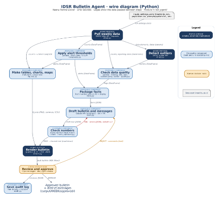

# atomic-agent-dhis2-surveillance-idsr-bulletin

This repository holds unit tests for the **Render bulletin** atomic protocol of the IDSR Bulletin Agent, an agentic AI workflow that turns weekly DHIS2 surveillance data into a checked, human-approved IDSR bulletin. The protocol is the [Quarto](https://quarto.org) command-line tool (Posit), which is the citable source; the tests call exactly the two commands the workflow uses.

## Wire diagram

The atomic protocol, Render bulletin (Quarto CLI 1.8.27), sits near the end of the workflow: it turns the number-checked bulletin text and summary table into the PDF and Word drafts that the epidemiologist reviews before approval.



## Contract

| | Type | Description |
|---|---|---|
| **Input** | `.qmd` file (UTF-8 text) | YAML title, number-checked bulletin text, pipe tables and links to PNG figures; English or French; no code chunks |
| **Output** | `.docx` or `.pdf` file | Word document (`--to docx`) or PDF via Typst (`--to typst`, no LaTeX needed); exit code 0 = success |

```bash
quarto render bulletin.qmd --to docx
quarto render bulletin.qmd --to typst
```

## Tested versions

- Quarto CLI 1.8.27 (installed separately from https://github.com/quarto-dev/quarto-cli/releases/tag/v1.8.27)
- pytest 8.4.2
- Python 3.11 or newer

## Setup

1. Install Quarto 1.8.27 and check with `quarto --version`.
2. Create the environment:

```bash
python3 -m venv .venv
source .venv/bin/activate   # Windows: .venv\Scripts\activate
pip install -r requirements.txt
```

## Running the tests

```bash
pytest -v
```

Expected result: `20 passed, 2 xfailed`. All test data are invented; no real patient or surveillance data are used.

## What the tests cover

- **Typical inputs:** Word and PDF output, YAML title, numbers kept exactly (`1,234`, `12.5%`, `<5`), tables, embedded figures, French accents, `--output` filename.
- **Edge cases:** empty file, header only, a 1,000-paragraph document, symbols in district names (`&`, `#`), the warning for a missing figure.
- **Invalid inputs:** missing input file, unknown output format, malformed YAML.

## Known limitations

These are marked `xfail(strict=True)`, so the suite fails loudly if a future Quarto release changes the behaviour:

- A missing figure only produces a warning; Quarto still exits 0 and makes the document.
- Non-UTF-8 text is silently replaced with "�" instead of raising an error.

The workflow's code must check for both before calling Quarto.

## Citation

Posit. (2025). *Quarto* (Version 1.8.27) [Computer software]. https://quarto.org